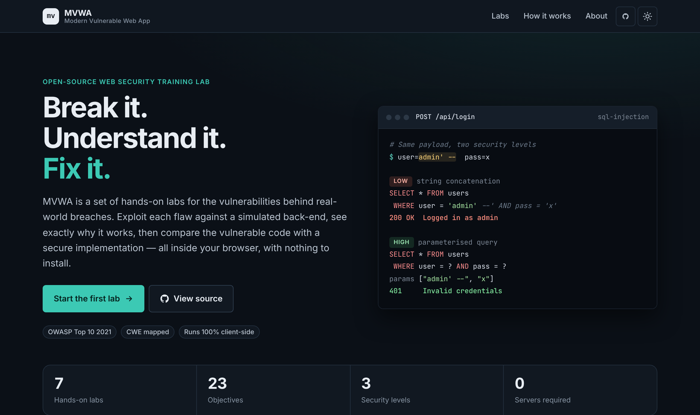
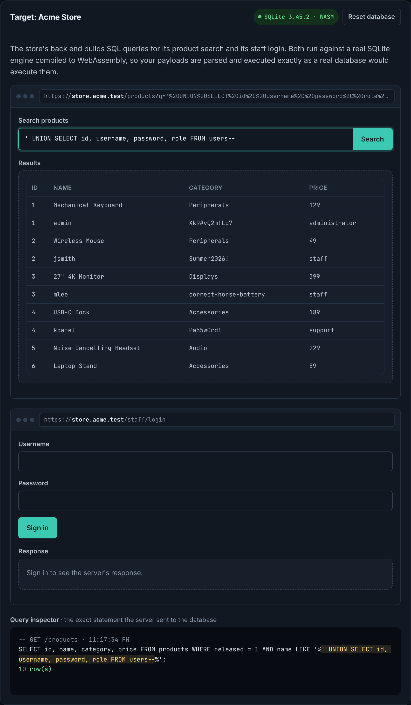

# Modern Vulnerable Web Application (MVWA)

An interactive, browser-based web security training lab. MVWA has seven hands-on labs covering the most common classes of web vulnerability. In each one you exploit a realistic simulated application, study the server-side code that made the attack possible, and then switch to a hardened implementation to see the same payload fail.

Every lab has three security levels (**Vulnerable**, **Weak mitigation** and **Secure**) and is mapped to the OWASP Top 10:2025 and a CWE identifier. Everything runs client-side as static files: there is no server to deploy, nothing to install, and no data leaves the browser.



## Labs

| # | Lab | OWASP Top 10:2025 | CWE | What you practice |
|---|-----|---------------------|-----|-------------------|
| 01 | SQL Injection | A05 Injection | [CWE-89](https://cwe.mitre.org/data/definitions/89.html) | Authentication bypass, `UNION`-based extraction and schema enumeration against a **real SQLite engine** (WebAssembly) |
| 02 | Cross-Site Scripting | A05 Injection | [CWE-79](https://cwe.mitre.org/data/definitions/79.html) | Reflected and stored XSS, filter evasion and session-cookie exfiltration. Payloads really execute and outbound requests are captured |
| 03 | Cross-Site Request Forgery | A01 Broken Access Control | [CWE-352](https://cwe.mitre.org/data/definitions/352.html) | Writing a malicious page that forges a bank transfer, against a model of the browser's cookie, `SameSite` and `Referer` rules |
| 04 | Insecure Direct Object Reference | A01 Broken Access Control | [CWE-639](https://cwe.mitre.org/data/definitions/639.html) | Tampering with REST API identifiers to reach other users' records and an admin API key |
| 05 | Path Traversal | A01 Broken Access Control | [CWE-22](https://cwe.mitre.org/data/definitions/22.html) | Escaping a download directory, then bypassing `../` stripping and double-decoding bugs |
| 06 | OS Command Injection | A05 Injection | [CWE-78](https://cwe.mitre.org/data/definitions/78.html) | Injecting into a `ping` utility through a simulated POSIX shell (separators, pipes, `$(…)`, backticks) |
| 07 | Denial of Service (ReDoS) | A06 Insecure Design\* | [CWE-1333](https://cwe.mitre.org/data/definitions/1333.html) | Catastrophic regex backtracking, with the exponential blow-up measured and charted live |

\* CWE-1333 is not in OWASP's official CWE list for any 2025 category. Filing it under Insecure Design is this project's own editorial choice.

Across the seven labs there are 23 objectives in total. Each is detected automatically when you achieve it, and your progress is saved locally in your browser.



## Security levels

| Level | Purpose |
|-------|---------|
| **Low: Vulnerable** | The textbook mistake, such as string concatenation, `innerHTML`, `shell=True` or a missing authorization check. |
| **Medium: Weak mitigation** | A plausible but flawed fix (a keyword blocklist, a substring `Referer` check, base64 "opaque" IDs, a length limit) that you learn to bypass. |
| **High: Secure** | The fix you would ship: parameterized queries, output encoding with CSP and `HttpOnly`, `SameSite` with synchronizer tokens, object-level authorization, path canonicalization, argument vectors, linear-time regexes. |

Every page shows the server-side code for the selected level, with the vulnerable or fixing lines highlighted. Each page also explains the root cause, the impact, why the weak fix fails, and how to remediate the flaw, with links to OWASP cheat sheets.

## Technical highlights

- **Real database engine.** The SQL injection lab runs [sql.js](https://github.com/sql-js/sql.js) (SQLite compiled to WebAssembly). Payloads are parsed and executed by SQLite itself, so stacked queries can really `DROP TABLE`, `sqlite_master` really reveals the schema, and prepared statements really neutralize the attack.
- **Faithful simulations.** The other back ends model real-world behavior instead of matching on keywords:
  - a POSIX-style shell interpreter with quoting, `;` `&&` `||` `&` `|` and command substitution;
  - Node's `path.join` and `path.resolve` semantics over a virtual Linux file system;
  - the browser's `SameSite`, `Referer` policy and `Origin` rules for cross-site requests;
  - Express-style query decoding.
- **Safe execution sandboxing.** XSS payloads run for real, but dialogs and requests to other hosts (`fetch`, XHR, `sendBeacon`, image beacons, WebSockets) are intercepted and logged instead of sent, and a Content Security Policy blocks any other route out of the page. ReDoS payloads run in a Web Worker with a hard timeout, so the tab never freezes.
- **No build step and no dependencies.** The site is plain HTML, CSS and vanilla JavaScript. A single registry in `assets/js/core.js` drives navigation, objectives and progress tracking.
- **Accessible, responsive UI.** The interface uses semantic markup, keyboard-friendly controls and visible focus states. Light and dark themes follow your system preference and can be toggled manually, and layouts work down to 360px wide.

## Getting started

MVWA is a static site. Serve the repository root with any static file server:

```bash
git clone https://github.com/ItsCats/Modern-Vulnerable-Web-Application.git
```

```bash
cd Modern-Vulnerable-Web-Application
```

```bash
python3 -m http.server 8080
```

Then open <http://localhost:8080>. (`npx serve .` works too.) Opening `index.html` directly from disk also works in most browsers, but a local server is recommended. The SQL injection lab loads sql.js from cdnjs, so it needs an internet connection the first time.

## Deployment

The repository deploys as-is to any static host (GitHub Pages, Netlify, Cloudflare Pages, Vercel):

- **GitHub Pages:** Settings, then Pages, then *Deploy from a branch*, then select `main` and `/ (root)`. Read the note below about origins first.
- **Netlify:** *Add new site*, then *Import an existing project*. Leave the build command empty and set the publish directory to `/`.

> **Host it on its own origin.** The XSS lab intentionally runs attacker-controlled script, and anyone can deliver it with a crafted `?q=` link. GitHub Pages project sites share the `username.github.io` origin, and with it `localStorage`, with every other Pages project on that account. Netlify, Cloudflare Pages or a dedicated subdomain keep the lab isolated.

## Project structure

```
├── index.html                  Landing page and lab catalog
├── labs/                       One page per lab
│   ├── sql-injection.html
│   ├── xss.html
│   ├── csrf.html
│   ├── idor.html
│   ├── path-traversal.html
│   ├── command-injection.html
│   └── redos.html
├── assets/
│   ├── css/
│   │   ├── styles.css          Design system: tokens, light/dark themes, components
│   │   └── home.css            Landing-page layout
│   └── js/
│       ├── core.js             Lab registry, navigation, security levels, progress, toasts
│       ├── home.js             Landing-page rendering
│       └── labs/               One simulated back end per lab, plus a shared virtual file system
└── docs/                       Screenshots
```

### Adding a lab

1. Add an entry (id, title, OWASP category, CWE, objectives) to `MODULES` in `assets/js/core.js`.
2. Create `labs/<id>.html` from an existing lab page. Mark level-specific content with `data-show-level="low|medium|high"`.
3. Create `assets/js/labs/<id>.js`. Call `MVWA.initLab({ id, levels, hints, onLevel })`, read `MVWA.getLevel()` inside your simulated server, and call `MVWA.complete("<objective-id>")` when an objective is achieved.

## Responsible use

MVWA is intentionally insecure and exists for education. The techniques it teaches are illegal to use against systems you do not own or have explicit written permission to test. Everything in this project runs locally in your own browser, so practicing here harms no one.

## Further reading

- [OWASP Top 10:2025](https://owasp.org/Top10/2025/)
- [OWASP Cheat Sheet Series](https://cheatsheetseries.owasp.org/)
- [PortSwigger Web Security Academy](https://portswigger.net/web-security)
